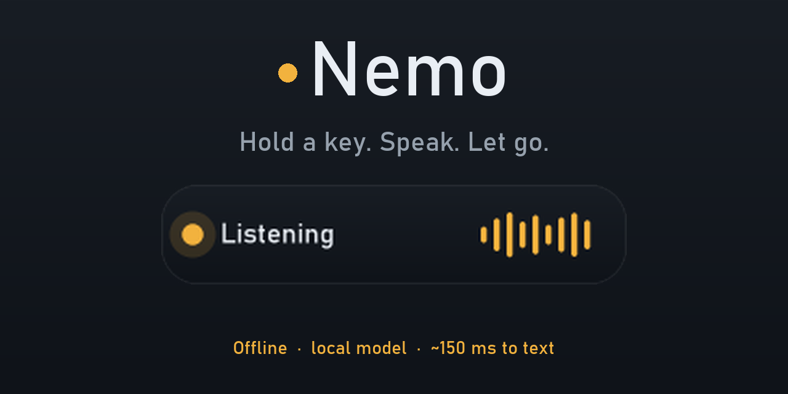
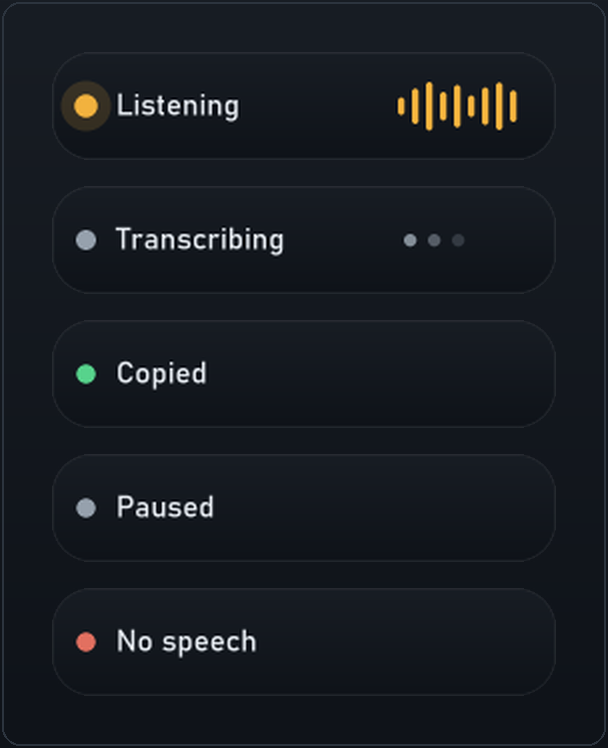

# Nemo

Right-Alt dictation. Whisper, offline, running locally on your own machine.

Hold a key, speak, let go; the text appears where you were typing. No account, no
cloud, no telemetry.

## Installing

**[Download Nemo-0.1-win64.zip](https://github.com/flyingsotong/nemo/releases/latest)**
- 48 MB, contains `Nemo.exe` and the engine it needs.

There is no installer. Unzip it into a folder and run `Nemo.exe` — settings, model and
logs all live beside the executable, so that folder *is* the installation. Windows 10
or 11, 64-bit.

Windows will warn that the executable is unsigned, because it is: "Windows protected
your PC", then **More info → Run anyway**. The binary is produced by `build.ps1` in
this repository from the code next to it, so if that trade is not acceptable you can
build it yourself in one command.

## Use

Start it from the Start menu (**Nemo**), or double-click `Nemo.exe`. Nothing
appears until you talk.

The first time you run it, Nemo offers to download a speech model, sized for your
hardware (0.5 GB without a GPU, 1.6 GB with one). Say yes and it fetches, verifies and
installs it; see **Getting the model** below. It then puts one pill on screen saying
**Hold Right Alt to talk** — once, because that is the only thing a new install
otherwise never tells you.

- **Hold Right Alt** and speak. A pill appears at the bottom of the screen
  showing **Listening** with a live level meter.
- **Release** and it sends immediately. The pill shows **Transcribing**, then
  **Copied**, and the text is pasted into the focused window.
- **Esc** while holding discards the recording.

Push-to-talk is the default because letting go is an unambiguous end to the
utterance, and it cannot be left recording by accident. If you would rather have
tap-to-start, tap-to-stop, set `DICTATION_MODE` to `"toggle"` in `config.json`.

Each paste ends with a space, so two dictations in a row do not run together as
`Hello.World`. Set `TRAILING_SPACE` to `false` if you would rather it did not.

The pill is the only feedback, and it is always the same small thing in the same
corner of the screen:

These are rendered by `overlay.render()`, the same function the running app draws
with, so they are the pixels you get rather than an illustration.

If nothing reaches the mic the pill says **No speech** and nothing is pasted.
The pill disappears on its own.

Right Alt is swallowed while Nemo runs, so it will not open menus or type AltGr
characters. Set `SUPPRESS_HOTKEY` to `false` in `config.json` to get it back, or
left-click the tray icon to pause and hand the key back temporarily.

## Privacy

Your audio is recorded into memory, posted to `127.0.0.1:8129` — a process on this
machine — transcribed there, and pasted. No account, no cloud, no telemetry.

The claim is narrow on purpose: **audio never leaves this PC**. The app does make one
outbound request, the optional model download you trigger yourself, and nothing else.
There is no code path that uploads audio.

Three ways to check rather than believe:

- Right-click the tray icon. It reports the engine (which GPU, or CPU) and the model
  file with its size on disk, read from the running process rather than hard-coded.
- Run `Nemo.exe --status`, which prints the engine, the loopback endpoint, the model
  path, the microphone and the privacy line as plain text. Add `--verify` and it
  hashes the model against the published digest, so you can confirm the file is the
  official one. That output is the useful thing to paste into a bug report.
- Block `Nemo.exe` in Windows Firewall. Dictation keeps working, because the only
  socket it opens is loopback.
- `bin-vk\whisper-server.exe` is a local binary answering on 127.0.0.1. Nothing in
  the repository opens an external connection except `--fetch-model`.

## Getting the model

The speech model is not in the repository: the default one is 1.6 GB, which neither
git nor a release asset should carry. Nemo fetches it from the official
`ggerganov/whisper.cpp` collection on Hugging Face and checks it.

    Nemo.exe --fetch-model                  what suits this machine (see below)
    Nemo.exe --fetch-model small.en         a specific one

Which model is worth having depends on the hardware, and the difference is large.
Measured on a 3.7-second phrase:

| Name | Download | GPU (Vulkan) | CPU only |
|---|---|---|---|
| `large-v3-turbo` | 1.62 GB | 114 ms | **8.7 s** |
| `small.en` | 0.49 GB | 112 ms | **1.7 s** |
| `large-v3-turbo-q5_0` | 0.57 GB | ~120 ms | ~4 s |
| `tiny` | 0.08 GB | ~100 ms | ~1 s |

On a GPU the model size makes no measurable difference, so take the accurate one. On
a CPU the same model is five times the wait. That is why `--fetch-model` with no name
probes the engine first and picks accordingly: `large-v3-turbo` when Vulkan is
present, `small.en` when it is not (or `large-v3-turbo-q5_0` if `LANGUAGE` is not
English, since `small.en` only speaks English). The first-run dialog does the same
and offers both, so you can overrule it.

Whichever you install, Nemo records it in `config.json` as `MODEL_FILE`, so the next
start uses it. Set `MODEL_FILE` yourself to switch between models you already have;
`--status` will tell you when the one in use is the wrong shape for the machine.

Downloads stream to a `.part` file, are hashed as they arrive, and are only renamed
into place when both the size and the SHA-256 match the published value. An
interrupted or corrupted download therefore cannot masquerade as a working model,
which matters because that would show up as an empty transcript rather than an error.
A killed download leaves a `.part` behind; those are swept on the next start rather
than sitting there invisibly.

If you prefer to fetch it yourself, put the file in `models\` and point `MODEL_FILE`
at it. The default file is `ggml-large-v3-turbo.bin`:

    https://huggingface.co/ggerganov/whisper.cpp/resolve/main/ggml-large-v3-turbo.bin
    sha256 1fc70f774d38eb169993ac391eea357ef47c88757ef72ee5943879b7e8e2bc69

## The tray icon

Nemo sits in the notification area with tooltip **"Nemo 0.1 - hold Right Alt to talk"**.
Right-click it:

| Item | What it does |
|---|---|
| **Nemo 0.1** | the version number, as a label |
| **GPU: ... (Vulkan)** | what is actually computing, from the engine's own startup banner; reads `CPU only (...)` when there is no GPU |
| **Model: ... (1.6 GB, on this PC)** | which model file is loaded, and how big it is on disk |
| **Local only: audio never leaves this PC** | the privacy claim, stated where you can see it |
| **Pause dictation** | checkable; this is also what a left click on the icon does |
| **Last: "..."** | the most recent transcript, truncated |
| **Copy last transcript** | puts it on the clipboard |
| **Insert last transcript** | pastes it again into the focused window |
| **Open settings (config.json)** | opens the config in your default editor |
| **Open vocabulary (vocabulary.txt)** | opens the word list |
| **Reload settings** | re-reads `config.json` and restarts the whisper server |
| **Start at login** | checkable; toggles the Run key |
| **Quit Nemo** | stops dictation and exits |

**Left-clicking the icon pauses dictation**; clicking again resumes. This exists
because Right Alt is swallowed globally, so without it the only way to get a real
Alt key back is to quit. While paused the icon dims to grey, the tooltip reads
`Nemo 0.1 - paused`, and Right Alt is handed back to Windows untouched. Press Right
Alt while paused and the pill says **Paused** rather than staying silent, so the
state can never be a mystery.

Confirmations for menu actions appear in the pill, not as Windows notifications. A
tray balloon goes through the Action Center and arrives about a second after the
click, which reads as lag, and Focus Assist can swallow it entirely; the pill is
already on screen and shows in about 30 ms.

The last-transcript items exist for when a paste lands in the wrong window or a
sentence comes out garbled: recover it instead of retyping. They are greyed out
until there is something to act on, and the history is the last ten utterances of
this session; it is not written to disk.

Vocabulary edits apply immediately and do not need **Reload settings**. That item
is only for `config.json`, because the server has to restart for a changed
language or thread count to take effect.

Windows 11 hides new tray icons in the overflow by default. If you do not see it,
open the overflow and drag Nemo onto the visible tray.

## Start at login

Already enabled. Nemo starts with Windows, so Right Alt works without launching
anything first. It registers itself in the per-user Run key, which is why no
administrator prompt is involved:

    Nemo.exe --startup on        enable
    Nemo.exe --startup off       disable
    Nemo.exe --startup status    current value

Because it starts hidden, the tray icon is the only sign it is running (apart
from Right Alt working). To turn it off again, run `--startup off`.

## Vocabulary

`vocabulary.txt` holds names, brands and jargon that whisper reliably misspells,
one per line. Nemo passes them to whisper as its initial prompt, which biases the
spelling and capitalisation of the output.

Copy `vocabulary.example.txt` to `vocabulary.txt` and edit it. The example is
deliberately generic, and `vocabulary.txt` is git-ignored so your own words stay
yours.

    Kubernetes
    PostgreSQL
    Wi-Fi 7

Lines starting with `#` are comments. The file is checked on every utterance and
re-read whenever its timestamp or size changes, so edits apply immediately with
no restart. Without the file Nemo simply runs with no prompt.

Measured effect on one sentence, in this case a name: without the term, "Tolaria"
came back as "Toleria"; with it, "Tolaria". The case of every other term was
unchanged in both directions.

Keep it to roughly a dozen entries. A long list starts shaping the writing style
of your dictation rather than just the spelling, and whisper truncates the prompt
once it exceeds its window, so extra lines silently stop mattering.

## Settings

`config.json` sits next to the exe, read at startup. Edit, then use **Reload
settings** in the tray, or restart Nemo.

| Key | Default | Notes |
|---|---|---|
| `MIC_DEVICE` | `"SB725 Soundbar"` | name substring, or a device number from `--list-devices` |
| `MODEL_FILE` | `"ggml-large-v3-turbo.bin"` | which file in `models\` to serve |
| `LANGUAGE` | `"en"` | `""` to auto-detect |
| `PASTE` | `true` | `false` = clipboard only, no keystrokes |
| `TRAILING_SPACE` | `true` | append a space after each paste so dictations do not run together |
| `SUPPRESS_HOTKEY` | `true` | `false` = let Right Alt through to apps |
| `OVERLAY` | `true` | `false` = no pill (silent mode) |
| `DICTATION_MODE` | `"push"` | `"toggle"` for tap-to-start, tap-to-stop |
| `BEEP` | `false` | `true` adds audio cues alongside the pill |
| `MIN_PEAK` | `0.012` | raise if room noise triggers false starts |
| `THREADS` | `6` | CPU threads for the parts that fall back to CPU |

## Troubleshooting

Diagnostic output goes to `nemo.log` as well as the console. The log is trimmed
to its last 400 lines once it passes 512 KB, so it cannot grow without bound.

    Nemo.exe --version             print the version and exit
    Nemo.exe --status              engine, model, microphone and privacy facts
    Nemo.exe --status --verify     also hash the model against the published digest
    Nemo.exe --list-devices        list microphones
    Nemo.exe --selftest 4          record 4s, print level and transcript
    Nemo.exe --file some.wav       transcribe a file
    Nemo.exe --startup status      is it set to start at login

If `peak` is below `MIN_PEAK`, that mic is not hearing you. If the pill does not
appear on a keypress, look in `nemo.log` for `pill setup failed` or
`pill render error`; a healthy run shows neither. If the tray is missing, the log
says `tray unavailable` with the reason.

## Layout

    Nemo.exe           the launcher (Python + deps + Pillow, ~27 MB)
    bin-vk\            whisper.cpp server + Vulkan ggml backends
    models\            the speech model, fetched with --fetch-model
    config.json        your settings
    vocabulary.txt     your words (copy vocabulary.example.txt)
    nemo.py            application: hotkey, recording, server, pasting
    tray.py            tray icon: quit, settings, reload, version
    overlay.py         the pill renderer
    make_icon.py       regenerates nemo.ico / nemo.png
    build.ps1          rebuilds Nemo.exe with the icon, manifest and hidden imports
    requirements.txt   pinned dependencies
    nemo.manifest      DPI-awareness manifest embedded in the exe
    nemo.ico/.png      the app icon
    RECORD.md          how it was built and what it cost to learn
    THIRD-PARTY-NOTICES.md   licences of everything bundled
    nemo.log           diagnostics

`Nemo.exe` is only the conductor. It needs `bin-vk\` and `models\` beside it, so
do not move the exe out of this folder.

## Running from source

The repository does not carry binaries or the model, so a clone needs two steps:

    python -m venv .venv
    .venv\Scripts\pip install -r requirements.txt
    .venv\Scripts\python nemo.py --fetch-model

`bin-vk\` comes from the release zip (it is whisper.cpp plus llama.cpp's Vulkan
ggml build, ~63 MB); drop it next to `nemo.py`. Then run `.venv\Scripts\python
nemo.py` for the app, or `pwsh -File build.ps1` to produce `Nemo.exe`.

## How it works

`bin-vk\whisper-server.exe` holds the model in GPU memory and answers HTTP on
127.0.0.1:8129. `Nemo.exe` records 16 kHz mono, posts the WAV, and pastes the
reply. Per-utterance cost is encoder time (~65 ms) plus overhead.

The hotkey hook is installed before the model is warmed, so Right Alt responds
about a second after launch instead of waiting out the ~3 s it takes to load the
model and raise the tray icon. A tap during that window waits for the server.

The GPU path is a deliberate overlay: whisper.cpp (b5454) publishes no Vulkan
build, so `bin-vk\` uses llama.cpp's Vulkan-enabled `ggml.dll`, `ggml-base.dll`,
`ggml-vulkan.dll` and CPU backends in place of whisper.cpp's. The ggml import
surface was verified compatible before the swap: `whisper.dll` imports 6 of
`ggml.dll`'s 16 exports and 92 of `ggml-base.dll`'s 690, all present.

Measured on the RX 9070 XT, 11-second clip, large-v3-turbo:

| Path | Time |
|---|---|
| CPU, stock whisper.cpp build | 8.14 s |
| CPU, zen4 backend | 6.15 s |
| GPU one-shot (model load each time) | 1.73 s |
| GPU, resident server | **0.13 s** |

## The pill

A bare Win32 window (no Tk) with per-pixel alpha, drawn with Pillow at 4x and
downsampled, then blitted via `UpdateLayeredWindow`. That is what makes the
curves genuinely smooth: a chroma-keyed Tk canvas can only do whole-pixel
transparency, which leaves visible stair-steps on an arc.

The downsampler is BOX, not Lanczos. The supersample factor is a power of two, so
BOX averages exactly whole pixel blocks: no ringing, and measurably faster. It
took a frame from 3.3 ms to 1.7 ms, which is the bulk of the render cost.

Details that are load-bearing, each learned the hard way:

- **`dpiAware` must be in the exe's manifest.** This display is 3840x2160 at
  150%. `python.exe` ships its own DPI-aware manifest, so running from source
  looks correct while the frozen exe, which has none by default, gets window
  geometry in logical units against physical monitor metrics and lands the pill
  off the bottom edge. `nemo.manifest` declares `permonitorv2`. A runtime
  `SetProcessDpiAwarenessContext` call is not enough once a manifest has
  established awareness at process start.
- **`WS_EX_TOPMOST`, re-asserted on every show.** Without it the pill renders
  perfectly and is then partly covered by whatever window owns that part of the
  screen.
- **`WS_EX_NOACTIVATE` is `0x08000000`.** `0x02000000` is `WS_EX_COMPOSITED`,
  which a layered window rejects with `ERROR_INVALID_PARAMETER` from
  `UpdateLayeredWindow`.
- **`WS_EX_TRANSPARENT` only** for click-through. Adding `WS_EX_LAYERED` without
  also calling `SetLayeredWindowAttributes` makes the whole window paint as
  fully transparent.
- Pixels must be **premultiplied BGRA** when using `ULW_ALPHA`.
- Level updates are dropped once 64 are queued, so a stalled renderer cannot grow
  memory without bound.
- Size, corner radius and palette are constants at the top of `overlay.py`.

## The icon

A rounded dark tile with an amber waveform, the same five-bar motif as the pill's
level meter. It is generated, not drawn by hand: `make_icon.py` renders at 4x and
emits `nemo.ico` at 16 through 256 px plus a 512 px `nemo.png`. Re-run it after
editing the colours or geometry.

## Building

    pwsh -File build.ps1

That is the whole build. The manifest, icon and three hidden imports matter, so
they are in the script rather than in shell history.

## Uninstalling

Delete this folder, the Start menu shortcut, and any startup shortcut.

## Licence

MIT for Nemo's own code; see `LICENSE`. Things it bundles keep their own terms, and
`THIRD-PARTY-NOTICES.md` lists each one. Two dependencies, `pynput` and `pystray`,
are LGPLv3 rather than MIT; they are redistributed unmodified, and `build.ps1` plus
`requirements.txt` are included so the bundle can be rebuilt with a replacement.

The speech model is not distributed. `--fetch-model` downloads it from the official
`ggerganov/whisper.cpp` collection on Hugging Face, under the model's own licence.
